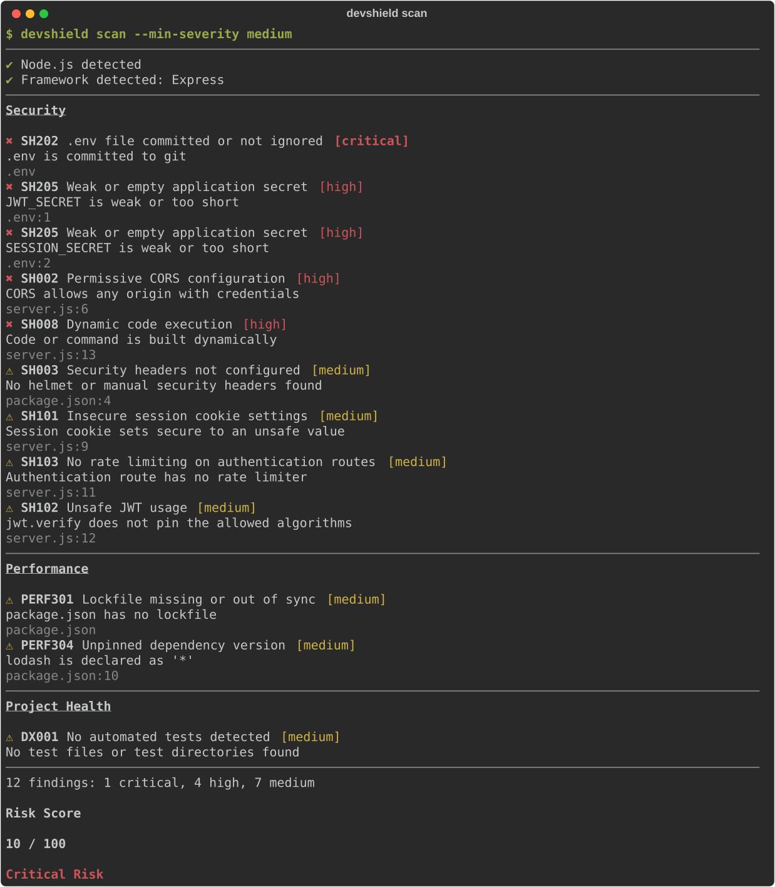
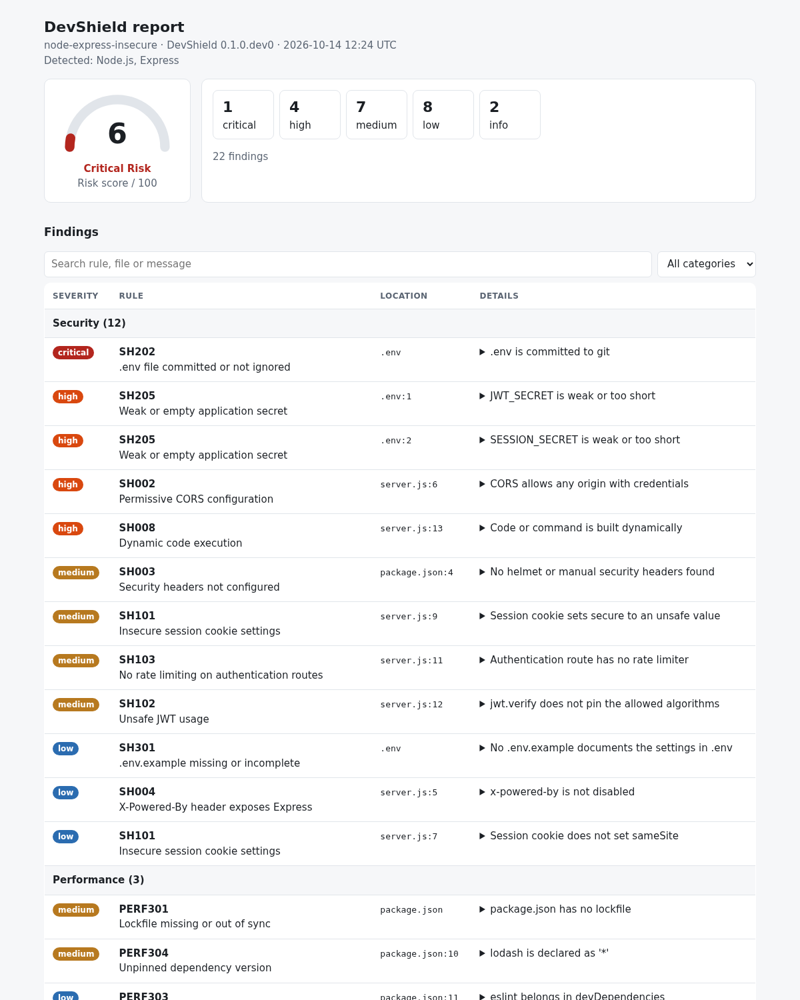
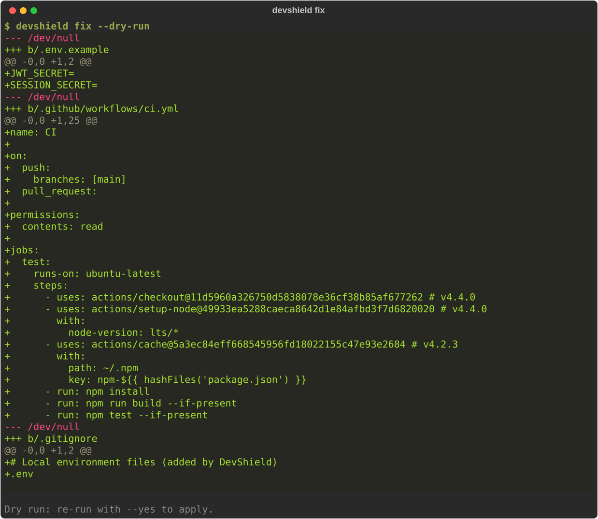
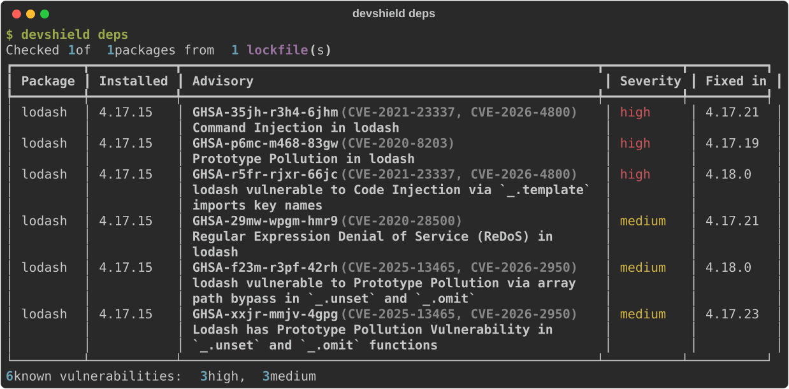
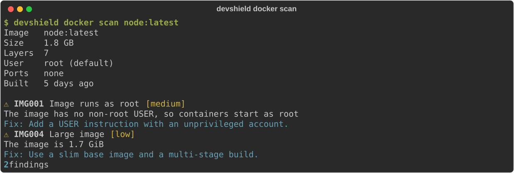

# DevShield

DevShield finds security, performance and configuration problems in web projects from one
command. It reads your files and never runs your code.

```bash
pipx install devshield-cli
devshield scan
```

- **75 rules** for Laravel, Node, Express, NestJS, React, Next.js, Django, FastAPI, Flask, Spring Boot,
  ASP.NET Core, Terraform, CloudFormation, Docker and GitHub Actions
- **Reports** as terminal, JSON, Markdown, HTML and SARIF for GitHub code scanning
- **Safe auto-fix** that only edits files, so `git checkout` undoes it
- **Dependency and image scanning** with OSV.dev and your local Docker
- **Baselines** to adopt it on an existing project without a wall of findings
- **Plugins** so you can add your own rules

## What it looks like



The HTML report is a single self-contained file with a risk gauge, search and category filters:



`devshield fix` previews exactly what it would change before it touches anything:



`devshield deps` and `devshield docker scan` cover dependencies and local images:





Start with [Getting started](getting-started.md).
